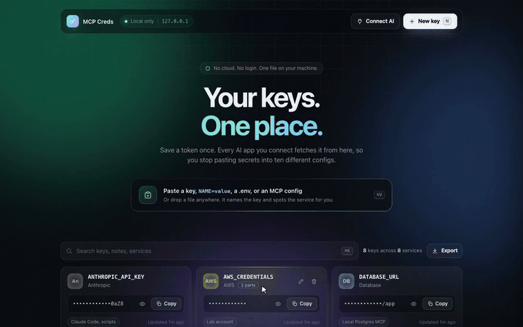
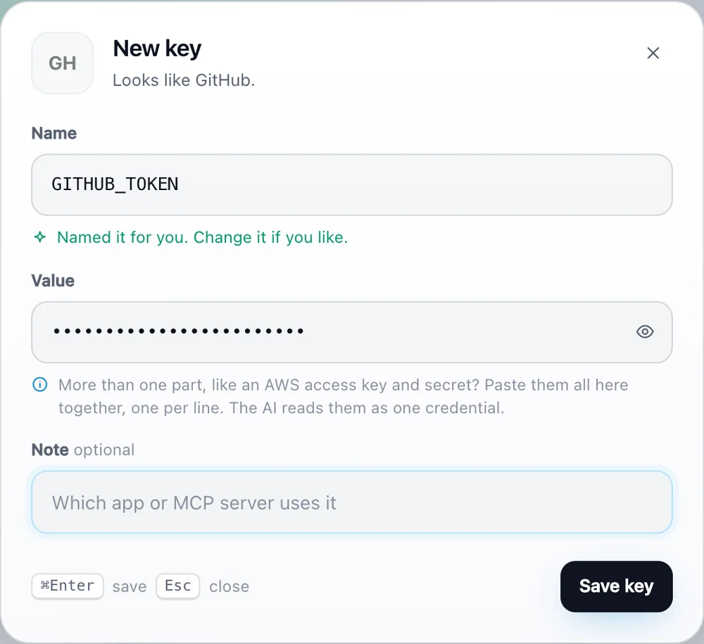
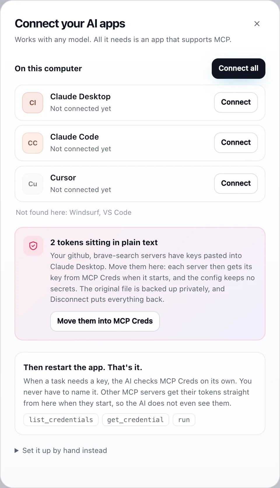

<p align="center">
  
</p>

<h1 align="center">MCP Creds</h1>

<p align="center">
  <b>Every API key your AI apps need. One local place.</b><br>
  Save a token once. Claude, Cursor, VS Code and any MCP app fetch it. No cloud, no login.
</p>

<p align="center">
  <a href="https://github.com/manishh-13/mcp-creds/releases/latest"></a>
  <a href="https://github.com/manishh-13/mcp-creds/actions/workflows/ci.yml"></a>
  <a href="LICENSE"></a>
  
  
</p>

<p align="center">
  <a href="https://manishh-13.github.io/mcp-creds/"><b>Website</b></a> &nbsp;&middot;&nbsp;
  <a href="https://github.com/manishh-13/mcp-creds/releases/latest"><b>Download</b></a> &nbsp;&middot;&nbsp;
  <a href="#connect-your-ai-apps"><b>How it works</b></a> &nbsp;&middot;&nbsp;
  <a href="#security"><b>Security</b></a>
</p>

<p align="center">
  
</p>

## Why

You use Claude Desktop, Cursor, VS Code, Windsurf... and every new MCP server wants its own token pasted into its own JSON config, in plain text. Rotate a key and you hunt through all of them.

MCP Creds fixes that. Save each key once in a clean little app, connect your AI apps with one click, and stop thinking about it:

- **Local only.** No cloud, no account, no telemetry. One JSON file on your machine.
- **Any model, any MCP app.** Claude, GPT, Gemini or a local model, inside Claude Desktop, Claude Code, Cursor, Windsurf, VS Code or any MCP client.
- **Zero dependencies.** One Python file plus one HTML page, or a ready-made desktop app.

## Get it

**Download the app** (no Python needed) from [Releases](https://github.com/manishh-13/mcp-creds/releases/latest):

| OS | File | First launch |
|---|---|---|
| macOS (Apple silicon) | `MCP-Creds-macOS.zip` | Unzip and drag to **Applications**. It is not notarized yet, so right-click it and choose **Open** the first time. |
| Windows | `MCP-Creds-Windows.zip` | Unzip and run `MCP Creds.exe`. If SmartScreen warns, choose **More info, Run anyway**. |
| Linux | `MCP-Creds-Linux.tar.gz` | Extract and run `./MCP Creds`. It opens in your browser. |

**Or run from source** (Python 3.9+, nothing to install):

```bash
git clone https://github.com/manishh-13/mcp-creds && cd mcp-creds
python3 mcpcreds.py ui
```

It opens in your browser, or in its own window if you `pip install pywebview`.

## What it does



- **Paste anything.** Copy a token and press Cmd/Ctrl+V anywhere in the app. It recognises 20+ services from the key itself (GitHub, OpenAI, Anthropic, Slack, Notion, AWS, Stripe, Hugging Face...) and names it for you.
- **Bring your existing setup.** Paste or drop a `.env`, a JSON file or your `claude_desktop_config.json`. It pulls every key out of your `mcpServers` and lets you pick. Placeholders like `<your-key>` are skipped.
- **Credentials with several parts** (an AWS access key, secret and session token): paste them all into one key, one per line. The AI reads every part, and `run` hands each server just the part it needs. Or split them into separate keys with one click.
- **Copy, reveal, edit, delete,** search by name, note or service, export everything as JSON.
- **Keyboard first:** `N` new key, `Cmd/Ctrl+K` search, `Esc` close.

<br clear="right">

## Connect your AI apps



Click **Connect AI**. MCP Creds finds the AI apps on your computer (Claude Desktop, Claude Code, Cursor, Windsurf, VS Code) and connects them with one click. It saves a private backup of each config first, and **Disconnect** puts everything back.

You never have to name a key. When a task needs one, the AI checks MCP Creds on its own through two tools: `list_credentials` (names only) and `get_credential`.

On macOS, move the app into **Applications** before connecting: AI apps remember where MCP Creds lives.

Prefer to do it by hand? The app shows the exact snippet for each app, or run `python3 mcpcreds.py config`:

```json
{
  "mcpServers": {
    "mcp-creds": {
      "command": "/Applications/MCP Creds.app/Contents/MacOS/MCP Creds",
      "args": ["mcp"]
    }
  }
}
```

<br clear="right">

### Stop pasting tokens into other MCP servers

Most MCP servers (GitHub, Slack, Notion, Brave Search...) read their token from an environment variable at startup, so the token sits in plain text in your config. MCP Creds spots these and offers to **move them**. The config then starts the server through MCP Creds:

```json
"github": {
  "command": "/Applications/MCP Creds.app/Contents/MacOS/MCP Creds",
  "args": ["run", "-e", "GITHUB_PERSONAL_ACCESS_TOKEN", "--", "npx", "-y", "@modelcontextprotocol/server-github"]
}
```

`run` puts the saved key into that server's environment and starts it. The config holds no secret, the AI never sees the token, and when a token changes you update it once. Use `-e VAR=KEY` when the variable name differs from your saved key's name.

## CLI

```bash
python3 mcpcreds.py set GITHUB_TOKEN ghp_xxx --note "GitHub MCP"
python3 mcpcreds.py get GITHUB_TOKEN        # print one value
python3 mcpcreds.py list
python3 mcpcreds.py rm GITHUB_TOKEN
python3 mcpcreds.py export > backup.json
python3 mcpcreds.py connect --secure        # connect all AI apps, move their tokens
python3 mcpcreds.py run -e GH=GITHUB_TOKEN -- some-mcp-server
```

The desktop app's binary accepts the same commands, for example `"/Applications/MCP Creds.app/Contents/MacOS/MCP Creds" list`.

## Security

Keys are stored in `~/.mcpcreds/store.json` (override with `MCPCREDS_HOME`). The folder is `0700` and the file `0600`, so only your user can read it. Writes are atomic and locked across processes.

Be honest with yourself about the threat model: values are **plain JSON protected by file permissions**, the same as `~/.aws/credentials` or a `.env` file. Anything running as your user can read them, and any AI app you connect can ask for them through MCP. Only connect apps you trust.

The app listens on `127.0.0.1` only, rejects requests whose `Host` is not localhost (blocks DNS rebinding), requires a random per-session token on every API call (blocks other websites) and cannot be framed. Config backups live in `~/.mcpcreds/backups`, never next to the config. Found a problem? See [SECURITY.md](SECURITY.md).

## Development

```bash
python3 -m unittest -v          # 39 tests, stdlib only
./packaging/build.sh            # build the desktop app for your OS into dist/ (needs uv)
```

Pushing a `v*` tag builds macOS, Windows and Linux apps in GitHub Actions, smoke-tests each one as an MCP server, and attaches them to the release. Issues and pull requests are welcome.

## License

[MIT](LICENSE)
